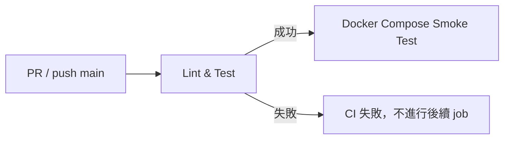

# CI 設定筆記

> 最後更新：2026/11/10
> 對應檔案：[.github/workflows/ci.yml](../.github/workflows/ci.yml)、[docker-compose.yml](../docker-compose.yml)、[Dockerfile](../Dockerfile)

## 1. 概覽

本專案使用 **GitHub Actions** 作為 CI，目的是在每次變更進來前自動確認：

1. 程式碼風格符合規範（Lint）
2. 測試全部通過（Test）
3. 以 `docker compose` 能成功建置並啟動 API 與 PostgreSQL，且資料庫遷移與健康檢查通過（Smoke Test）



## 2. 觸發時機

| 事件 | 說明 |
|------|------|
| `pull_request` | 任何 PR 開啟或更新時執行 |
| `push` 到 `main` | 合併進 `main` 後再執行一次，確保主線健康 |

## 3. Job 說明

### 3.1 Lint & Test（`lint-test`）

| 步驟 | 指令 | 說明 |
|------|------|------|
| Checkout | `actions/checkout@v4` | 取得原始碼 |
| 設定 Node | `actions/setup-node@v4` | Node **24**，並啟用 `npm` 快取 |
| 安裝相依 | `npm ci` | 依 `package-lock.json` 嚴格安裝，確保可重現 |
| Lint | `npm run lint` | 執行 `eslint .` |
| 測試 | `npm test` | 使用 Node 內建 test runner |

### 3.2 Docker Compose Smoke Test（`docker-compose`）

- `needs: lint-test`：Lint / Test 通過後才會執行，節省資源。
- 使用 `docker-compose.yml` 同時啟動 **API（`api`）** 與 **PostgreSQL（`postgres`）**，驗證兩者能一起運作。
- 不推送映像檔，執行完畢後會清理環境。

| 步驟 | 指令 | 說明 |
|------|------|------|
| 驗證語法 | `docker compose config -q` | 檢查 compose 設定是否合法 |
| 建置並啟動 | `docker compose up -d --build --wait` | 依 `Dockerfile` 建置 API，等待服務 healthy／running |
| 資料庫遷移 | `docker compose exec -T api npx typeorm migration:run -d db/data-source.js` | 確認遷移可在全新資料庫上執行 |
| 健康檢查 | `curl --fail --retry 10 ... http://localhost:3000/health` | `/health` 必須回傳 200，失敗會重試最多 10 次 |
| 失敗輸出 log | `docker compose logs`（僅失敗時） | 方便從 CI 頁面直接看原因 |
| 清理 | `docker compose down -v`（一律執行） | 移除容器、網路與 volume |

> CI 沒有 `.env`，因此會採用 `docker-compose.yml` 內的預設值（帳密、DB 名稱、API 對外埠號 3000）。

## 4. 本機如何重現 CI

提交 PR 前，建議先在本機跑一遍，避免 CI 紅燈：

```bash
npm ci               # 乾淨安裝相依
npm run lint         # 檢查程式碼風格
npm test             # 執行測試

# Smoke Test（需先停掉本機正在跑的 API，避免埠號衝突）
docker compose up -d --build --wait
docker compose exec -T api npx typeorm migration:run -d db/data-source.js
curl --fail http://localhost:3000/health   # 若 .env 有設定 PORT，請改用該埠號
```

> ⚠️ **請勿隨意執行 `docker compose down -v`**：`-v` 會刪除 `pacer_pg_data` volume，本機資料庫的資料會一併消失。只想停止服務請用 `docker compose down`。

`npm test` 實際執行的是：`NODE_ENV=test LOG_LEVEL=silent node --test "tests/**/*.test.js"`。

## 5. Dockerfile 與 docker-compose.yml 的分工

| 檔案 | 負責內容 |
|------|----------|
| `Dockerfile` | 多階段建置 API 映像檔：`deps` 階段只裝正式環境套件，`runner` 階段以非 root 的 `node` 使用者執行 `node bin/www.js` |
| `docker-compose.yml` | 編排 `api` 與 `postgres`：`api` 以 `build: .` 使用 Dockerfile，並等待 `postgres` healthy 後才啟動 |

重點設定：

- `api` 的 `DATABASE_URL` 主機名稱必須是 `postgres`（service 名稱），容器內的 `localhost` 指向 API 自己。
- `.dockerignore` 排除了 `.env`，環境變數一律由 compose 的 `environment` 傳入。
- 容器內 API 固定監聽 3000，主機對外埠號由 `${PORT:-3000}` 決定。

## 6. 注意事項

- **遷移不會自動執行**：`synchronize` 為 `false`，API 啟動時不會建立資料表，所以 CI 與本機首次啟動都需手動跑 migration。
- **不要把 `.env` 提交到版本庫**：CI 不依賴 `.env`；本機請參考 `.env.example` 自行建立。
- **Node 版本需一致**：CI 與 Dockerfile 都使用 Node 24，本機請使用相同主版本。
- **修改 `package.json` 後務必更新 `package-lock.json`**，否則 `npm ci` 會失敗。
- **預設帳密僅限本機與 CI 使用**：正式環境請改用密鑰管理，不要沿用 compose 內的預設值。

## 7. 常見問題排除

| 症狀 | 可能原因 | 處理方式 |
|------|----------|----------|
| `npm ci` 失敗 | `package.json` 與 lock 檔不一致 | 本機執行 `npm install` 後提交更新的 lock 檔 |
| Lint 失敗 | 程式碼不符合 ESLint 規則 | 本機執行 `npm run lint` 並修正 |
| 測試只在 CI 失敗 | Node 版本或環境變數不同 | 確認本機為 Node 24，並使用 `npm test` |
| `compose up --wait` 逾時 | API 或 DB 啟動失敗 | 看 CI 的 `docker compose logs` 輸出，或本機 `docker compose logs api` |
| 遷移步驟失敗 | migration 檔有誤，或無法連到 DB | 本機用全新 volume 重現，確認 `DATABASE_URL` 主機為 `postgres` |
| 健康檢查失敗 | API 未啟動或資料庫連線異常 | 查看 `docker compose logs api` |
| 本機埠號衝突 | `npm run dev` 與 `pacer-api` 同時佔用同一埠 | 擇一執行，或 `docker compose stop api` |

## 8. 未來可擴充方向

- 將映像檔推送到 Container Registry（例如 GHCR），並於 `main` 合併後自動發佈
- 加入測試覆蓋率報告，並設定 Branch Protection：CI 通過才能合併
- 使用 Docker layer cache（`docker/build-push-action` 搭配 cache）加速建置
- 在 `api` 加上 `healthcheck`，讓 compose 的等待條件更精準
